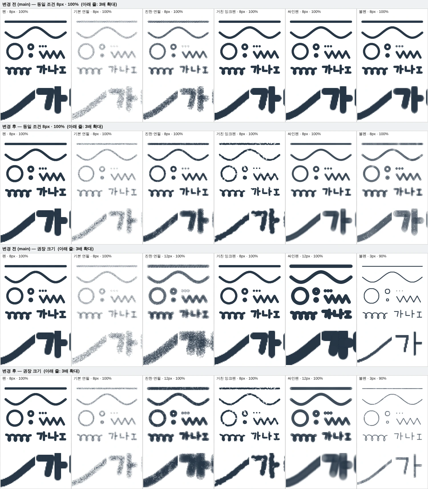

# 브러시 6종의 시각적 차별화

`main` `013bb3b` 기준. 새 브러시·새 설정·새 의존성은 없습니다. 펜과 지우개의 렌더링은 바꾸지 않았습니다.

위에서부터 ① 변경 전 8px·100% ② 변경 후 8px·100% ③ 변경 전 권장 크기 ④ 변경 후 권장 크기. 각 칸의 아래 줄은 3배 확대입니다. 모든 칸은 같은 색(#283747)과 같은 입력 경로(직선·곡선·원·점·지그재그·짧은 손글씨)를 실제 엔진(`Paint.begin/point/end`)으로 그린 결과입니다.

## 왜 비슷해 보였나

| 브러시 | 변경 전 방식 | 결과 |
| --- | --- | --- |
| 거친 잉크펜 | 팁 외곽을 반지름의 2.5% 안에서만 흔듦 | 8px에서 0.1px 차이. 펜과 구분 불가 |
| 싸인펜 | 펜과 같은 경로를 두 겹(바깥 28%)으로 그림 | 포인터 이벤트마다 바깥 겹이 겹쳐 금방 포화. 펜과 같아지고 이벤트 분할에 따라 결과가 달라짐 |
| 볼펜 | 팁 알파 76%에 ±1% 수준 변화 | 스탬프가 겹치면 균일한 선 |
| 연필 2종 | 팁 안의 픽셀 노이즈 | 스탬프 중첩으로 입자가 메워지고, 화면을 축소하면 회색 펜처럼 보임 |

공통 원인은 **질감이 팁 안에만 있어서 스탬프가 겹치면 사라진다**는 점입니다. 그래서 수치를 키우지 않고 질감을 두는 위치를 바꿨습니다.

## 바꾼 방식

1. **종이 결** (`src/paper-grain.ts`): 브러시 종류마다 256×256 텍스처를 고정 시드로 한 번 만들어 캔버스 좌표에 고정합니다. 획 타일을 레이어에 합성할 때 적용하므로 스탬프가 아무리 겹쳐도 남습니다. 같은 자리를 다시 그으면 같은 결이 다시 드러납니다.
2. **획 길이 방향 변화** (`src/basic-brushes.ts`): 폭·농도·끊김을 스탬프 순번의 해시로 정합니다. 순번은 이동 거리로만 증가하므로 포인터 이벤트 분할·프레임과 무관하게 같은 경로는 같은 결과를 냅니다.
3. **팁 단면**: 브러시마다 단면 형태를 다르게 했습니다(아래 표).

| 브러시 | 팁 · 가장자리 | 선 내부 | 길이 방향 |
| --- | --- | --- | --- |
| 펜 | 변경 없음 | 균일 | 균일 |
| 기본 연필 (HB) | 좁고 옅은 심 | 고운 입자가 많이 비는 종이 결 | — |
| 진한 연필 (4B) | 넓고 평평한 심, 부드러운 경계 | 굵고 무른 결, 진한 곳은 결이 메워짐 | — |
| 거친 잉크펜 | 단단한 경계. 변형 4종의 물어뜯긴 외곽 | 진한 중심 + 드문 마른 빈틈 | 느린 굵기 변화와 스탬프별 좌우 치우침으로 양쪽 외곽이 따로 흔들림 |
| 싸인펜 | 넓은 번짐 경계 | 살짝 비치는 균일한 몸통, 경계 안쪽이 조금 더 진함(수성 잉크가 가장자리로 모이는 모습) | 균일 |
| 볼펜 | 단단한 테두리, 중심이 조금 옅음 | 미세한 핀홀 | 농도가 천천히 변하고 가끔 약하게 끊김 |

고유 설정(외곽 거칠기·가장자리 부드러움·농도 변화)은 각 효과의 세기를 조절합니다. 0%면 잉크펜의 빈틈과 볼펜의 농도 변화·핀홀이 없어집니다.

### 함께 바뀐 동작

- **싸인펜**이 경로 방식에서 거리 스탬프 방식으로 바뀌어, 다른 브러시처럼 입력 분할과 무관하게 재현됩니다.
- **싸인펜·볼펜의 탭(이동 없는 클릭)** 은 획이 끝날 때 한 번 더 눌러 찍어 선과 같은 농도의 점이 됩니다.
- 싸인펜 몸통은 100% 불투명도에서도 약 88% 농도입니다(왕복하면 메워짐). 획 불투명도 설정은 그 결과에 그대로 곱해집니다.
- 모든 효과는 명목 굵기 안쪽으로만 작용하므로 변경 타일 계산과 Undo 영역은 그대로입니다.

## 호환성

- 저장 형식·프리셋·도구 설정 스키마 변경 없음. 기존 프리셋의 `texture.amount`를 그대로 읽습니다.
- 이미 그린 픽셀은 바뀌지 않습니다. 달라지는 것은 앞으로 긋는 획의 모양입니다.
- Undo/Redo는 기존 타일 패치 방식 그대로입니다.

## 성능

- 팁은 종류·크기·색·설정 조합마다 한 번 생성해 캐시합니다(기존 24개/2 MiB 상한 유지). 잉크펜의 변형 4종은 한 캐시 항목 안에 나란히 둡니다. 팁 해상도 상한은 192px → 128px.
- 종이 결 텍스처는 종류당 256 KiB, 최대 4장(약 1 MiB)이며 처음 쓸 때 한 번 만듭니다.
- 프레임별 난수·필터·블러를 쓰지 않습니다.
- 추가 비용은 결이 있는 브러시에서 **변경된 타일 하나당 `drawImage` 2~3회**(128×128)입니다. 스탬프 수는 잉크펜 동일, 볼펜 약 30% 감소, 싸인펜은 경로 2회 대신 스탬프입니다.

이 환경(소프트웨어 렌더링 Chromium, 1600×1200 캔버스, 포인트마다 합성)에서 변경 전·후를 번갈아 2회씩 잰 중앙값입니다. 실제 기기 수치가 아닙니다.

| 브러시 (권장 크기) | 작은 원 1획 (전 → 후) | 긴 획 이벤트당 (전 → 후) |
| --- | --- | --- |
| 펜 8px (변경 없음) | 52 → 50 ms | 3.3 → 3.2 ms |
| 기본 연필 8px | 52 → 11 ms | 3.3 → 0.23 ms |
| 진한 연필 12px | 51 → 11 ms | 3.2 → 0.28 ms |
| 거친 잉크펜 8px | 52 → 11 ms | 3.3 → 0.28 ms |
| 싸인펜 12px | 51 → 52 ms | 3.3 → 3.5 ms |
| 볼펜 3px | 51 → 11 ms | 3.3 → 0.29 ms |

느려진 브러시는 없습니다. 싸인펜은 측정 오차 범위입니다. 결이 있는 4종이 오히려 빨라진 것은 의도한 최적화가 아니라 부수 효과입니다: 큰 마스크 캔버스를 레이어에 직접 그리던 것이 128px 임시 타일을 거치게 되면서, 이 환경에서 비싼 큰 캔버스 간 복사를 피합니다. 실제 GPU 환경에서 같은 폭으로 나타난다고 보장할 수 없습니다. 작은 원 1획의 대부분(약 10 ms)은 획 시작 시 원본·마스크 캔버스 할당으로, 이번 변경과 무관합니다.

## 한계

- 필압·속도 입력을 쓰지 않으므로 G펜의 강약(입·빼기)은 표현하지 않습니다. 굵기 변화는 거리 기반의 고정 패턴입니다.
- 종이 결은 256px 주기로 반복됩니다. 가는 선에서는 보이지 않지만 100px 굵기로 넓게 칠하면 반복이 보일 수 있습니다.
- 볼펜은 권장 크기(2~4px)에서 단단한 선으로 보이고, 8px 이상에서는 가장자리가 다소 무르게 보입니다.

## 검증

- 브러시 관련 핵심 테스트를 먼저 실행: `basic-brushes.spec.ts`, `pencil-guides.spec.ts`.
- 신규 검사 1개(`6종 8px 구분`): 펜 폭 편차 0, HB < 4B 농도, 잉크펜 폭 편차·진한 중심, 싸인펜 균일 몸통·더 진한 테두리·부분 투명 경계, 볼펜 농도 변화·끊김, 탭 점 농도.
- 수정한 기존 검사 2곳: 싸인펜도 입력 분할 독립을 요구하도록 예외 제거(강화), 싸인펜 반투명 획 검사를 "50% 획 = 100% 획의 절반"으로 변경(몸통이 살짝 비치게 된 사양 반영).
- 재현성·1px 점·취소·화면 밖 스탬프·팁 캐시·Undo/Redo·PNG/PSD/mpaint/자동 복구 검사는 그대로 통과.
- 최종 빌드와 전체 회귀는 1회 실행. 결과는 `VALIDATION.md`.
